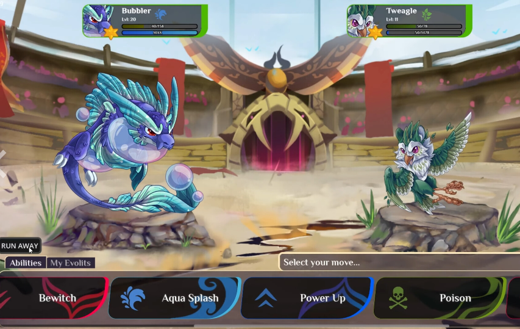
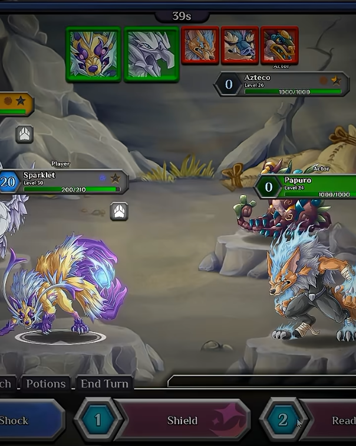
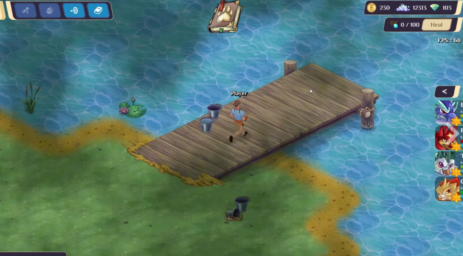
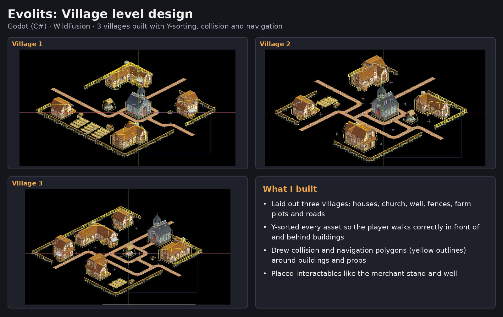
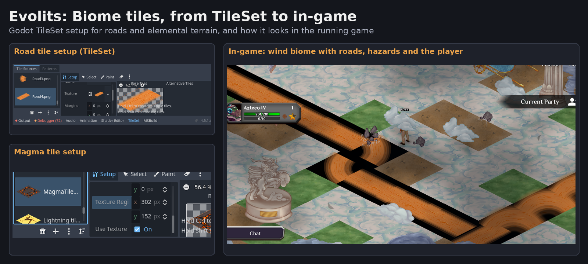
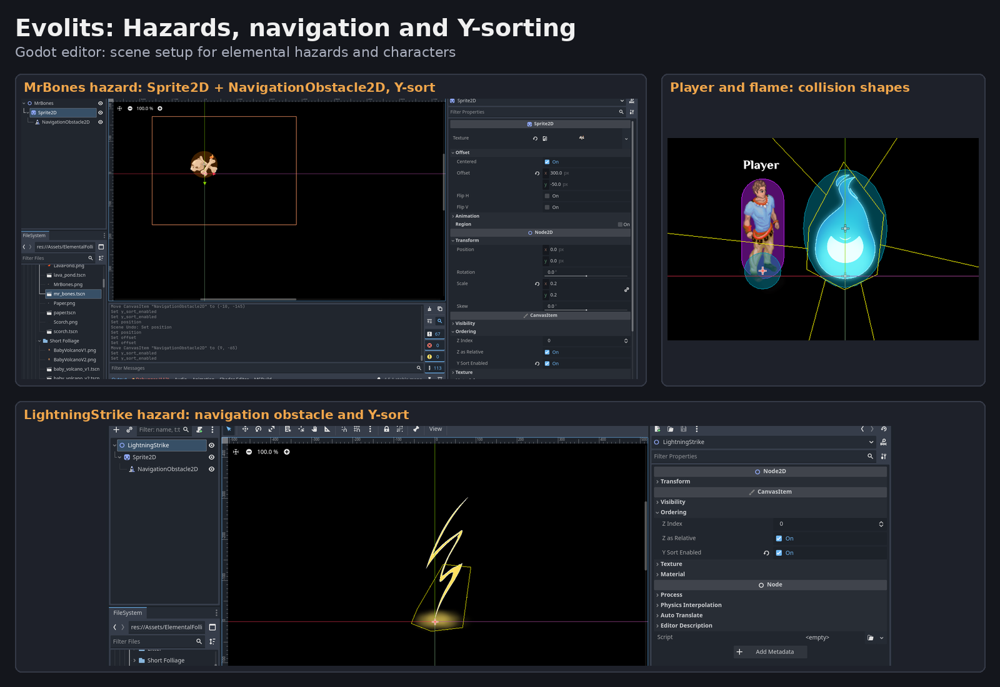

# Hi, I'm Ritwik 👋

**Gameplay programmer** working in **Godot (C#)** and **Unity**. I build the systems players actually touch: abilities, status effects, progression, and the VFX and SFX that make them feel good.

## 🎮 Recent work: Evolits @ WildFusion

*Evolits* is a co-op, creature-collecting open-world roguelite with turn-based PvE and PvP combat, built in Godot (C#) for PC and mobile. As a Logic Design Engineer at WildFusion (remote, Aug 2025 – Jun 2026), I:

- Implemented, tested and tuned creature **abilities across every element**, including polarity, icons and descriptions
- Built **VFX** for abilities and potions, and created **SFX for every elemental and physical ability**
- Wrote the **rune scaling logic**, potions and **status effects** (root, shield, silence, type negation)
- Built **dungeons, vaults, villages, the Gauntlet maps** and elemental biome environments, including Y-sorting and navigation

*The Evolits codebase is private, so my commits show up as private contributions on this profile.*

## 🖼️ Portfolio

**In-game: abilities, VFX and battles**

**Level design: three villages built in Godot with Y-sorting, collision and navigation**

**Biome tiles: from TileSet setup to in-game**

**Hazards, navigation and Y-sorting in the Godot editor**

## 🛠️ Tools

`Godot` · `C#` · `Unity` · `VFX` · `SFX` · `Git`

## 📫 Get in touch

I'm open to **Gameplay Programmer / Game Developer** roles: remote, hybrid or on-site, and comfortable working across time zones from Bangladesh (UTC+6).

- LinkedIn: [linkedin.com/in/ritwikbiswas-dev](https://www.linkedin.com/in/ritwikbiswas-dev)
- Email: ritwikbiswas2106@gmail.com
